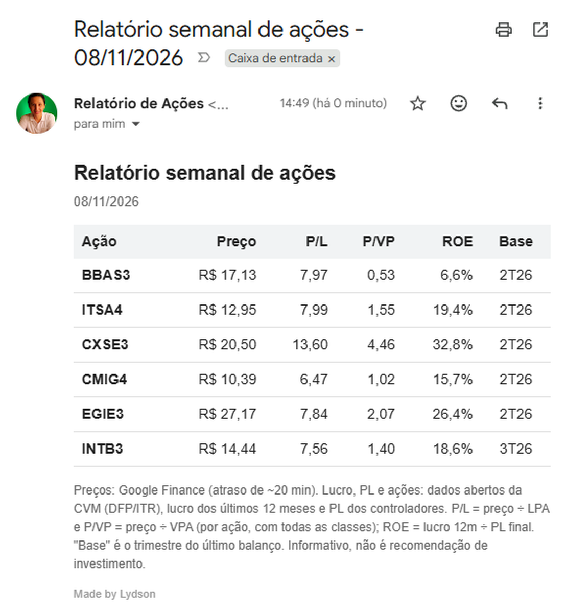

# Relatório semanal de ações da B3

> Made by Lydson

Todo domingo à noite um robô recalcula os fundamentos de 6 ações da B3 a partir dos **dados abertos da CVM**, e toda segunda às 8h chega um e-mail com **preço, P/L, P/VP e ROE** de cada uma. Tudo gratuito, sem API paga e sem guardar nenhuma senha.

<!-- Depois de recortar o print do e-mail (sem o seu endereço e foto), salve em docs/email.png e remova os comentários da linha abaixo -->
<!--  -->

**Ações acompanhadas:** BBAS3, ITSA4, CXSE3, CMIG4, EGIE3 e INTB3.

## Como funciona

```
CVM (DFP + ITR) ──► GitHub Actions (semanal) ──► data/fundamentos.csv
                                                        │
Google Finance (preço) ──► Google Sheets ◄── Apps Script lê o CSV
                                │
                                ▼
                  Apps Script (segunda, 8h) ──► e-mail HTML
```

1. **`fundamentos_cvm.py`** baixa os arquivos DFP (anual) e ITR (trimestral) da CVM, acha as empresas pelo nome, confere os CNPJs e calcula lucro 12m, patrimônio líquido e quantidade de ações.
2. **GitHub Actions** (`.github/workflows/atualizar_fundamentos.yml`) roda o script toda semana e publica `data/fundamentos.csv`. Não usa nenhum segredo, só o token automático do GitHub.
3. **`enviar_relatorio.gs`** (Apps Script) baixa o CSV, atualiza a aba `Fundamentos` da planilha, lê a aba `Painel` (preço via `GOOGLEFINANCE` + fórmulas) e envia o e-mail.

### Por que calcular em vez de usar uma API?

APIs gratuitas de cotação/fundamentos costumam limitar o plano gratuito (poucos ativos, indicadores restritos) e criam dependência de terceiros. Os dados da CVM são oficiais, gratuitos, sem limite de requisições e **auditáveis**: cada número do e-mail pode ser rastreado até uma conta do balanço.

## Definições

| Indicador | Cálculo |
|---|---|
| Lucro 12m | DFP do último exercício + ITR acumulado do ano − ITR acumulado do mesmo período do ano anterior (lucro atribuído aos controladores) |
| PL | Patrimônio líquido consolidado − participação dos não controladores |
| LPA | Lucro 12m ÷ (ações ON + PN, sem tesouraria) |
| VPA | PL ÷ (ações ON + PN, sem tesouraria) |
| P/L | Preço ÷ LPA |
| P/VP | Preço ÷ VPA |
| ROE | Lucro 12m ÷ PL final do último balanço |

P/L e P/VP são calculados **por ação** (preço do ticker ÷ LPA/VPA), como fazem os principais sites. Isso supõe que ON e PN têm o mesmo LPA e VPA.

## Validação

Os números foram conferidos manualmente em nov/2026 contra sites públicos de análise (Investidor 10, Status Invest e outros): lucro 12m, VPA e ROE bateram com diferença abaixo de ~2% nas ações conferidas. Durante a validação foram encontrados e corrigidos três problemas reais, que mostram por que a conferência é necessária:

- **Escala das ações:** a CVM não informa se a quantidade de ações vem em unidades ou em milhares (varia por empresa). O VPA (PL ÷ ações) serve como teste de sanidade.
- **Linha de controladores zerada:** em um ITR, a empresa deixou "lucro atribuído aos controladores" em zero. O script usa, nesse caso, lucro consolidado − não controladores.
- **Cache desatualizado:** o ZIP do ITR muda toda semana na CVM, então o cache expira em 3 dias.

## Limitações conhecidas

- **Lucro contábil vs. ajustado.** A CVM traz o lucro contábil. Bancos como o BBAS3 destacam o lucro ajustado, então o ROE do relatório diferirá do divulgado pelo banco.
- **ROE sobre o PL final**, não o médio. Pode diferir 1 a 2 p.p. de sites que usam PL médio.
- **Eventos corporativos** entre a data-base e hoje (ofertas de ações, bonificações, desdobramentos) distorcem P/L e P/VP até o próximo ITR. Exemplo: oferta de ações da EGIE3 em jul/2026.
- **Datas-base diferentes** entre empresas. A coluna "Base" do e-mail mostra o trimestre de cada uma.
- **Escala das ações manual.** Ao adicionar um ticker, confira o VPA e ajuste `ESCALA_ACOES` em `fundamentos_cvm.py` se estiver 1000× fora.
- **Plano de contas de bancos** é diferente; só o BBAS3 foi validado.
- **`GOOGLEFINANCE`** pode devolver erro; o e-mail mostra "n/d" nesses casos.

## Como usar

### 1. Rodar localmente
```bash
pip install -r requirements.txt
python fundamentos_cvm.py
```
Gera `data/fundamentos.csv` (e `data/fundamentos_sheets.csv` em formato pt-BR para importar no Sheets).

### 2. Trocar as ações
Edite os dicionários `EMPRESAS` (regex do nome da empresa na CVM) e `ESCALA_ACOES` em `fundamentos_cvm.py`.

### 3. Planilha (Google Sheets, pt-BR)
- Aba `Fundamentos`: importe `data/fundamentos_sheets.csv` (separador `;`).
- Aba `Painel`, linha 1: `Ticker | Preço | Ações ON | Ações PN | LL 12m | PL | Data-base | LPA | P/L | P/VP | ROE`. Na coluna A (a partir da linha 2), os tickers. Fórmulas da linha 2:

```
B2: =GOOGLEFINANCE("BVMF:"&A2;"price")
C2: =PROCV($A2;Fundamentos!$A:$L;9;0)
D2: =PROCV($A2;Fundamentos!$A:$L;10;0)
E2: =PROCV($A2;Fundamentos!$A:$L;7;0)
F2: =PROCV($A2;Fundamentos!$A:$L;8;0)
G2: =PROCV($A2;Fundamentos!$A:$L;3;0)
H2: =E2/(C2+D2)
I2: =SE(H2>0;B2/H2;"n/d")
J2: =B2/(F2/(C2+D2))
K2: =E2/F2
```

### 4. E-mail automático
- No Apps Script da planilha, cole `enviar_relatorio.gs` e troque `SEU_USUARIO/SEU_REPO` em `URL_FUNDAMENTOS` pelo seu repositório.
- Rode `enviarRelatorio` uma vez (autorize o Gmail e o acesso externo) e depois `criarTriggerSemanal` para agendar o envio de segunda, às 8h.

### 5. Atualização automática
Em *Actions*, habilite os workflows e rode **Atualizar fundamentos (CVM)** uma vez. Depois ele roda sozinho toda semana. Em repositório público, o GitHub desativa agendamentos após 60 dias sem atividade; o workflow grava `data/ultima_atualizacao.txt` a cada execução para evitar isso.

## Privacidade

O projeto usa apenas dados públicos (CVM e Google Finance). Não há credenciais no repositório, e o e-mail é enviado para a própria conta que autorizou o Apps Script.

## Fontes

- [Dados Abertos da CVM](https://dados.cvm.gov.br/): DFP e ITR de companhias abertas.
- Google Finance: cotações, com atraso de cerca de 20 minutos.

## Aviso

Projeto educacional e informativo. **Não é recomendação de investimento.**
